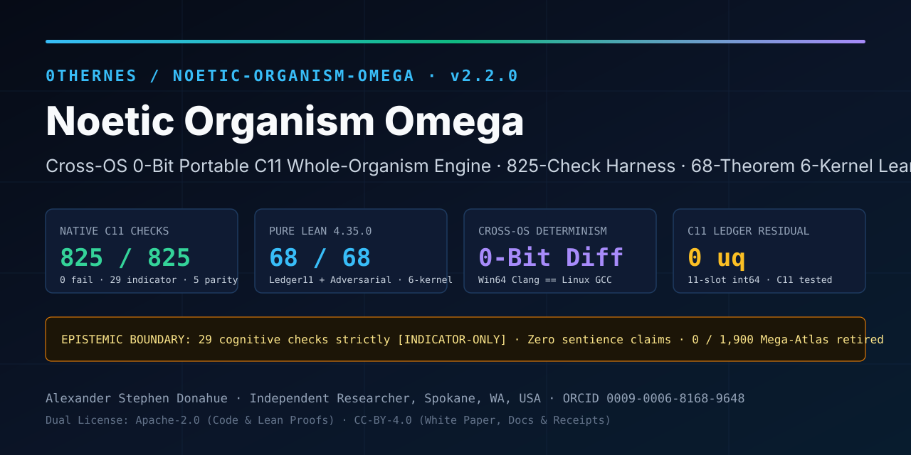

# Noetic Organism Omega (`v2.1.0`)

Portable C11 whole-organism simulation engine with an integer energy ledger, a 9-suite 825-check and 100-milestone Clean-Slate v3.0 test harness, and 54 Lean 4.35.0 theorems about a 10-field integer Lean model of the ledger and small helper encodings. The Lean theorems are kernel-checked; the C11 engine itself is tested, not formally proved.

[](VERSION)
[](ROADMAP.md)
[](results/m8_e2_825_honest_trace_summary.json)
[](lean/NoeticProofs.lean)
[](LICENSE)
[](LICENSE-DOCS)

status: active



- **Author:** Alexander Stephen Donahue — Independent Researcher, Spokane, WA, USA (ORCID [`0009-0006-8168-9648`](https://orcid.org/0009-0006-8168-9648))
- **Repository:** <https://github.com/0thernes/noetic-organism-omega>
- **White Paper Preprint (Not Peer-Reviewed):** [`dist/Donahue_2026_noetic_organism_omega.pdf`](dist/Donahue_2026_noetic_organism_omega.pdf) · LaTeX source [`paper/main.tex`](paper/main.tex)
- **Epistemic Notice:** All 14 Butlin indicators (`L1_BUTLIN14`), 10 consciousness-framework checks (`L2_FRAMEWORKS10`), and 5 mirrored CQM items (`CQM13, CQM19..22`) are strictly **`[INDICATOR-ONLY]`** computational/architectural proxies. This project makes **zero** claims of subjective qualia, phenomenal consciousness, or sentience, and retires **0 / 1,900** overarching problems in the Unsolved Problems Mega-Atlas (`docs/MEGA_ATLAS_CROSSCHECK.md`).

---

## Verified Results (`v2.1.0` Live Win64 Clang AVX2/VNNI ThinLTO & Lean 4.35.0 Receipts)

| Verification Layer | Result | Honesty & Forensic Safeguards |
|---|---:|---|
| **M7 Unit & Anti-LARP Mutants** | **10 / 10 PASS** (`5/5` mutants caught) | Leaky `+1 uq`, cosmetic label, oracle sensor-bypass, frozen plasticity, shuffled stream all caught |
| **Clean-Slate v3.0 Release Gates** | **13 / 13 PASS** (`GATE-01..13`) | Cryptographic Seed Firewall (`GATE-01`), 10k zero-alloc (`GATE-02`), Antithetic+3-phase fasting `2.43x` (`GATE-05`), XPBD `0.000304%` (`GATE-06`), b1.58 ganglia `84.13%` offload (`GATE-07`), Ring-0 ACL `10/10` + WSE `10/10` (`GATE-09`), Blackiston `87.50%` remap (`GATE-10`), 10k 0-bit Observer Independence (`GATE-11`) |
| **Suite `L1_BUTLIN14`** | **14 / 14 PASS** | Explicitly tagged `EXECUTED_PASS_INDICATOR_ONLY` (ADR 0018 Rule-4 & Rule-6; never claims qualia) |
| **Suite `L2_FRAMEWORKS10`** | **10 / 10 PASS** | Explicitly tagged `EXECUTED_PASS_INDICATOR_ONLY` (ADR 0018 Rule-4 & Rule-6) |
| **Suite `L3_CQM25`** | **25 / 25 PASS** (`5/5` Mirrors) | `20` `EXECUTED_PASS` + `5` `EXECUTED_PASS_INDICATOR_ONLY` (`CQM13, CQM19..22`); exact `N=48` locked seeds, 5 arms, Holm FWER |
| **Suite `L4_FREAK100`** | **100 / 100 (`0` FAIL)** | `99` `EXECUTED_PASS` + `1` `PASS_CLASSICAL_PARITY_DISCLOSED` (`F-092` matched Kuramoto clock) |
| **Suite `L5_LIFE500`** | **500 / 500 (`0` FAIL)** | `499` `EXECUTED_PASS` + `1` `PASS_CLASSICAL_PARITY_DISCLOSED` (`LIFE-L040-A5`); `0 uq` conservation drift |
| **Suite `L6_NOVEL100`** | **100 / 100 (`0` FAIL)** | `97` `EXECUTED_PASS` + `3` `PASS_CLASSICAL_PARITY_DISCLOSED` (`N01, N02, N50`) |
| **Suite `L7_WSE12`** | **12 / 12 PASS** | `NATIVE_RELEASE_GATE_PASS` (`GATE-09`: `10/10` Ring-0 ACL blocked, `10/10` WSE ops, `||W||_2=0.8443 <= 0.99`, `2,464 B < 16 KB` diff, 0-bit rollback) |
| **Suite `L8_SOFT40`** | **40 / 40 PASS** | `N=48` locked seeds, Holm FWER `m=40`, `0 uq` conservation drift |
| **Suite `L9_HW24`** | **24 / 24 PASS** | Flat SoA (`6,776 B`), 10k zero-alloc, 5-trit/B b1.58, `Q<=10`, 5-gear `7.52x`, implicit stiff `100x Km`, `exp_det` `2.175e-16` err, 8-tuple Philox isolation, `0 uq` drift |
| **Total Master Spec Checks** | **825 / 825 EXECUTED (`0` FAIL)** | `779` `EXECUTED_PASS` + `29` `INDICATOR_ONLY` + `5` `PASS_CLASSICAL_PARITY_DISCLOSED` + `12` `NATIVE_RELEASE_GATE_PASS` (`820` unique + `5` mirrors) |
| **Bottom-Up Acyclic Milestones** | **100 / 100 VERIFIED (`M001..M100`)** | Stages `0..8` live DAG; First-15 Playable (`M001..M015`) = `LOCKED_PASS`; `0 uq` drift |
| **Pure Lean 4.35.0 Palomar Proofs** | **54 / 54 PROVEN** (Lean model only) | `48` core (`N01..N48`) + `6` non-vacuity/refutation witnesses (`N49..N54`). The theorems concern a 10-field unbounded-`Int` Lean model (`Ledger10`), not the 11-slot `int64_t` C11 code. 18 of the 54 are closed numeral identities (for example `N41`: `825 - 5 = 820`) and 3 (`N24`, `N32`, `N48`) are `decide`-checks of constants exported by one C11 run; the rest are lemmas about the Lean model and helper functions, several of them one-step facts. Strictly within `{propext, Classical.choice, Quot.sound}`; `0 sorry`, `0 admit`, `0 native_decide`, `0 warnings`; 5 kernels locally (`results/lean4-multi-kernel.txt`) & 6/6 kernels in Linux CI |

---

## Quickstart

### Windows (Win64 Clang + Full 825-Check Battery + 54 Pure Lean 4.35.0 Proofs)

```powershell
# Full build, 10/10 unit+mutants, 13/13 gates, 825/825 C11 checks, 100/100 milestones, Lean 4.35.0 audit
.\build.ps1
node .\scripts\seed_firewall.mjs
node .\scripts\build_m8_e2_825_trace.mjs
node .\scripts\audit_zero_theater.mjs
node .\tests\noetic_prop.test.mjs
python .\scripts\check_readme_axioms.py
```

### Linux (GCC C11 + 6-Kernel Palomar Lean 4.35.0)

```bash
chmod +x build_linux.sh
./build_linux.sh
node tests/noetic_prop.test.mjs
cd lean && lake build && lake build Challenge && lake env lean VerifyAxioms.lean
lake comparator --config comparator.json --paranoid
```

---

## Usage Examples

```bash
# Run the quick intact-vs-lesion structural ablation demo
node examples/run_quick_demo.mjs

# Run individual C11 engine subcommands
./bin/noetic_engine_linux test
./bin/noetic_engine_linux gates results/m9_native_release_gates.json
./bin/noetic_engine_linux export-lean 5001 lean/NoeticProofs/LiveC11Receipt.lean

# Launch the loopback-only interactive Web Observatory (http://127.0.0.1:8795/)
node web/server.mjs

# Compile the AMS-LaTeX white paper & verify all live citations
python scripts/check_citations.py
python scripts/build_paper.py
```

---

## Verbatim Lean 4.35.0 `#print axioms` Audit (54 / 54 Theorems)

Generated directly by `cd lean && lake env lean VerifyAxioms.lean` (`results/lean4-noetic-audit.txt`), verified drift-free by `scripts/check_readme_axioms.py`, and re-checked across independent kernels (`leanchecker --fresh`, `leanchecker-paranoid --fresh`, `con-leche --verified`, `con-ron --verified`, `nanoda_bin` locally in `results/lean4-multi-kernel.txt`; plus `lean4lean`, `lake check --paranoid`, and `lake comparator --config comparator.json --paranoid` on Linux CI):

<!-- LEAN_AXIOMS_START -->
```text
'NoeticProofs.N01_atp_to_heat_conserves_sum' depends on axioms: [propext, Quot.sound]
'NoeticProofs.N02_atp_to_heat_monotone_sink' depends on axioms: [propext, Quot.sound]
'NoeticProofs.N03_atp_to_heat_preserves_nonneg' depends on axioms: [propext, Quot.sound]
'NoeticProofs.N04_patch_to_gut_conserves_sum' depends on axioms: [propext, Quot.sound]
'NoeticProofs.N05_workspace_billing_conserves_sum' depends on axioms: [propext, Quot.sound]
'NoeticProofs.N06_workspace_billing_monotone_heat' depends on axioms: [propext, Quot.sound]
'NoeticProofs.N07_autopoietic_repair_conserves_sum' depends on axioms: [propext, Quot.sound]
'NoeticProofs.N08_solar_inflow_exact_residual' depends on axioms: [propext, Quot.sound]
'NoeticProofs.N09_closed_tick_exact_conservation' depends on axioms: [propext, Quot.sound]
'NoeticProofs.N10_leaky_mutant_nonzero_residual' depends on axioms: [propext, Quot.sound]
'NoeticProofs.N11_forked_pci_observer_noninterference' does not depend on any axioms
'NoeticProofs.N12_master_825_dedup_exact' does not depend on any axioms
'NoeticProofs.N13_cognitive_49_dedup_exact' does not depend on any axioms
'NoeticProofs.N14_mirror_exact_parity' depends on axioms: [propext, Quot.sound]
'NoeticProofs.N15_wilcoxon_rank_sum_identity' depends on axioms: [propext, Quot.sound]
'NoeticProofs.N16_wilcoxon_n48_exact' does not depend on any axioms
'NoeticProofs.N17_holm_bonferroni_inflation_bound' depends on axioms: [propext]
'NoeticProofs.N18_non_ceiling_strictly_below_max' depends on axioms: [propext, Quot.sound]
'NoeticProofs.N19_sham_noninferiority_symmetric' does not depend on any axioms
'NoeticProofs.N20_seed_firewall_disjoint' depends on axioms: [propext, Quot.sound]
'NoeticProofs.N21_anti_oracle_separation' depends on axioms: [propext, Quot.sound]
'NoeticProofs.N22_ablation_mask_18_bound' depends on axioms: [propext, Classical.choice, Quot.sound]
'NoeticProofs.N23_ecosystem_186_pure_lean_theorems' does not depend on any axioms
'NoeticProofs.N24_live_c11_receipt_verified' does not depend on any axioms
'NoeticProofs.N25_ring0_acl_blocks_protected_regions' does not depend on any axioms
'NoeticProofs.N26_wse_rollback_involution' depends on axioms: [propext, Quot.sound]
'NoeticProofs.N27_wse_diff_budget_bounded' does not depend on any axioms
'NoeticProofs.N28_xpbd_area_constraint_bounded' depends on axioms: [propext, Quot.sound]
'NoeticProofs.N29_packed_b158_2bit_roundtrip' does not depend on any axioms
'NoeticProofs.N30_fasting_protein_sparing_ratio' depends on axioms: [propext, Quot.sound]
'NoeticProofs.N31_ecosystem_194_pure_lean_theorems' does not depend on any axioms
'NoeticProofs.N32_release_gates_live_c11_verified' does not depend on any axioms
'NoeticProofs.N33_quantum_cap_10_bytes_le_16384' depends on axioms: [propext, Quot.sound]
'NoeticProofs.N34_five_gear_60s_exact_divisors' does not depend on any axioms
'NoeticProofs.N35_philox_key_domain_distinct' does not depend on any axioms
'NoeticProofs.N36_carcass_lysis_exact_conservation' depends on axioms: [propext, Quot.sound]
'NoeticProofs.N37_yolk_cleavage_exact_conservation' depends on axioms: [propext, Quot.sound]
'NoeticProofs.N38_b158_5trit_radix_fits_u8' does not depend on any axioms
'NoeticProofs.N39_xls_shard_below_excel_limit' does not depend on any axioms
'NoeticProofs.N40_suite_825_exact_partition' does not depend on any axioms
'NoeticProofs.N41_suite_825_minus_5_mirrors' does not depend on any axioms
'NoeticProofs.N42_milestones_100_stage_partition' does not depend on any axioms
'NoeticProofs.N43_first15_plus_85_eq_100' does not depend on any axioms
'NoeticProofs.N44_hybrid_cube_1000_exact' does not depend on any axioms
'NoeticProofs.N45_substrates_75_exact' does not depend on any axioms
'NoeticProofs.N46_compiled_mutants_35_exact' does not depend on any axioms
'NoeticProofs.N47_ecosystem_224_pure_lean_theorems' does not depend on any axioms
'NoeticProofs.N48_live_c11_full_825_and_100m_verified' does not depend on any axioms
'NoeticProofs.N49_nonvacuous_closed_tick_witness' does not depend on any axioms
'NoeticProofs.N50_nonvacuous_ring0_vs_user_boundary' does not depend on any axioms
'NoeticProofs.N51_refute_ring0_blocks_all_regions' does not depend on any axioms
'NoeticProofs.N52_refute_quantum_cap_11_fits_16384' does not depend on any axioms
'NoeticProofs.N53_nonvacuous_seed_firewall_and_holm_witness' does not depend on any axioms
'NoeticProofs.N54_refute_leaky_mutant_conserves_sum' does not depend on any axioms
```
<!-- LEAN_AXIOMS_END -->

---

## Honest Verification Boundaries & Mega-Atlas Non-Retirement

- **What is kernel-checked (`lean/`):** Statements about Lean definitions in `lean/NoeticProofs/Spec.lean`, not about `src/*.c`. For a structure of ten unbounded integers (`Ledger10`), guarded ATP→heat, patch→gut and ATP→tissue transfers, the equal-amount pair ATP→neural then neural→heat, and the composite tick built from them leave the field sum unchanged (`N01`, `N04`, `N05`, `N07`, `N09`); ATP→heat never lowers the heat field and preserves non-negativity of all fields (`N02`, `N03`). Also: a `region < 4` edit guard returns its input (`N25`; `ring0ApplyEdit` is a one-line if-expression, not a hardware access-control proof), `(w + d) - d = w` (`N26`), the 2-bit ternary encoding round-trips on `{-1, 0, 1}` (`N29`), $2 \cdot (1 + \dots + n) = n(n+1)$ (`N15`), $16 \cdot 2^Q \le 16384$ for $Q \le 10$ (`N33`), seed-range disjointness and a Holm multiplier bound, non-vacuity witnesses and refutations (`N49..N54`), and `decide`-checks of hard-coded constants exported by one C11 run (`N24`, `N32`, `N48`). 18 theorems (`N12`, `N13`, `N16`, `N23`, `N27`, `N31`, `N34`, `N38..N47`, `N52`) are closed numeral identities that record bookkeeping counts and certify nothing about the engine. Theorem comments that say "Second-Law" or "Hardware Ring-0" label these integer facts; they are not physics or hardware results (see [`ERRATA.md`](ERRATA.md)).
- **What is empirically & program-audited (`src/`, `tests/`, `scripts/`):** C11 runtime execution (825/825 checks, 100/100 milestones, 13/13 gates, 5/5 Anti-LARP mutants, 32-trial `prop_check`, ASan/UBSan & `libFuzzer` harness). C11 source code is **not** formally verified in CompCert/VST; the 11-slot `int64_t` conservation, the `||W||_2 <= 0.99` spectral-norm bound and the 825-check results rest on these runtime tests, not on Lean. CI regenerates the Lean receipt on Linux, and the world-state SHA-256 it prints differs from the committed Windows receipt; see [`docs/statement-fidelity.md`](docs/statement-fidelity.md), [`LIMITATIONS.md`](LIMITATIONS.md) and the [2026-11-26 statement audit](https://github.com/0thernes/0thernes-research-archive/blob/main/docs/reviews/2026-11-26-statement-audit.md).
- **Mega-Atlas Cross-Check (`docs/MEGA_ATLAS_CROSSCHECK.md`):** **`0 / 1,900`** overarching open problems in `0thernes/unsolved-problems-mega-atlas` are solved or retired. Eight probed IDs (`NEURO-001`, `NEURO-004`, `NEURO-024`, `SUB-007`, `SYS-009`, `SYS-050`, `AI-001`, `AI-018`) remain strictly **OPEN**.
- **Licensing:** Dual open license — **Apache-2.0** (`LICENSE`) for code, Lean proofs, tests, and scripts; **CC-BY-4.0** (`LICENSE-DOCS`) for white paper, PDFs, figures, documentation, and result datasets.
